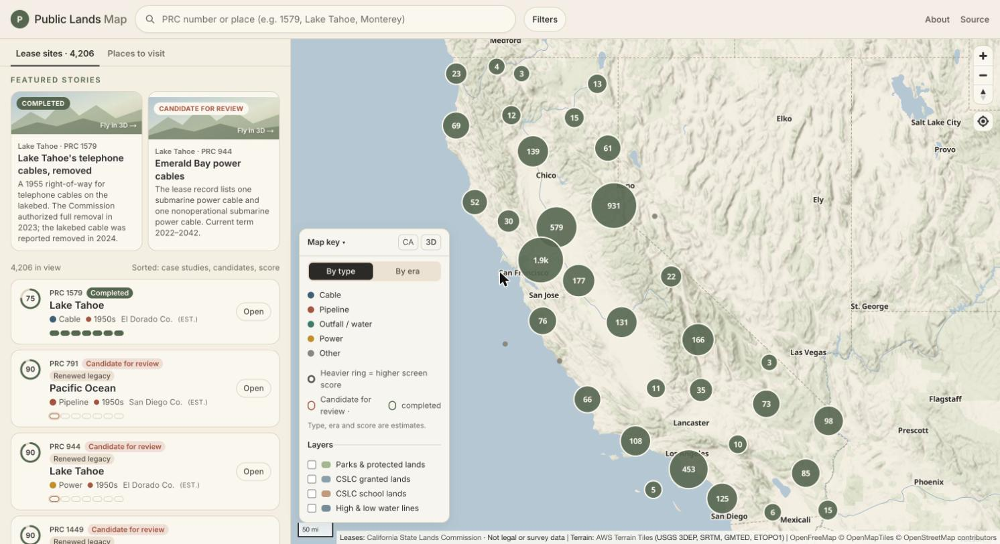
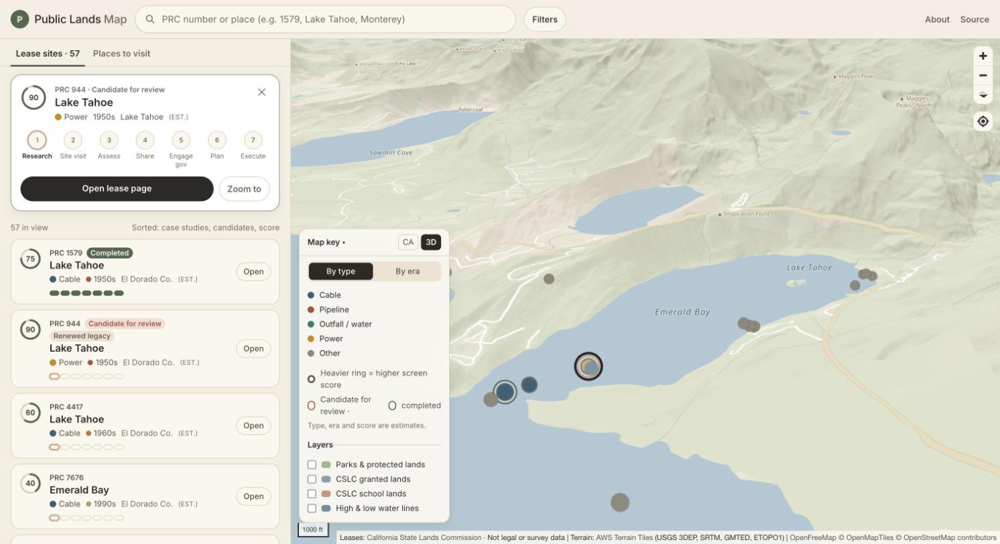

# California Public Lands Map

An interactive map of the California State Lands Commission's public lease records, shown next to the parks and
protected lands people can visit.

**Live:** https://publiclands-map.vercel.app · **About and methodology:** https://publiclands-map.vercel.app/about





## Why public lands

California holds the beds of its navigable lakes and rivers, its tidelands, and the ocean floor out to three miles in
trust for the public. The State Lands Commission (CSLC) manages these lands. It issues leases for what gets built on
them: pipelines, power and telephone cables, outfalls, intakes, wharves and marinas. Some of those leases are more than
70 years old.

The Commission publishes its lease records as a public GIS layer. In that form they are hard to browse. This map makes
them easy to explore: you can see what is leased where, read each lease's own description, and follow a lease to its
Commission records. Old leases sometimes list facilities the state's own text calls non-operational or abandoned. The
map labels these leases **candidates for review**: a reading list, not a finding.

## What's on the map

- **4,206 CSLC lease sites** (5,524 points) from the public lease layer, clustered and colored by likely type (cable,
  pipeline, outfall, power, other) or by estimated era. A subtle ring shows a "read this file first" screen score.
- **Candidates for review:** 7 leases whose Improvements text, written by the Commission, says non-operational or
  abandoned, on an old lease renewed on a new term. Each one quotes that text.
- **Public spaces:** parks, beaches and protected lands from CPAD, served as vector tiles (PMTiles) so they can be on by
  default. More layers in the map key: CSLC granted lands, state school lands, and partial high and low water lines.
- **Layout:** the list is on the left, with big Public spaces and Leases buttons that switch each layer on the map and in
  the list. The map key and filters are on the right.
- **Deep links:** `?layers=spaces,leases` (the default), `?layers=leases`, or `?layers=spaces`. Filters and the selected
  lease are kept in the URL too, for example `?layers=leases&era=1950s&prc=944`, and `?story=944` plays a story.
- **Lease pages** (`/lease/<PRC>`): facts quoted from the layer, estimates with their reasons, a locator map in 3D, and
  share images.
- **Featured stories** fly in over 3D terrain: PRC 1579, Lake Tahoe telephone cables, removed; and PRC 944, Emerald Bay
  power cables.

Every estimated field (type, era, issue year, county, waterbody, region, score) is labeled "est." and shows how it was
worked out. `RecordStatus: Active` in the layer is the layer's record status. It is not evidence that a facility is in
use.

> **Not legal or survey data.** See the [California State Lands Commission](https://www.slc.ca.gov/) for official records.

## Run it

Requires Node 22.18+ (Node 24 recommended). No API keys.

```bash
npm install
npm run dev        # http://localhost:3100
npm run build && npm start
```

`npm run dev` and `npm run build` first run `scripts/sync-data.mjs`. It reads the snapshots committed in `data/` and
writes what the app serves (`public/data/`, `data/generated/`). Builds never call CSLC.

`DATA_SOURCE=fixture npm run dev` uses a 41-lease sample for quick UI work.

Optional inputs, all off by default:

- `OVERLAYS_DIR`: your own GeoJSON layers (see below).
- `LAYERS_DIR`: alternative land-layer files.
- `FIXTURE_LAYERS=1`: placeholder outlines for UI work.
- `NEXT_PUBLIC_BACK_URL` and `NEXT_PUBLIC_BACK_LABEL`: a header link.
- `NEXT_PUBLIC_NOINDEX=1`: keeps a deployment out of search engines.

## Build your own layer

You can draw your own data on top of the lease map: field notes, survey points, a route, a study area.

1. Save a GeoJSON FeatureCollection (WGS84 longitude/latitude) as `data/overlays/<id>.geojson`. Points, lines and
   polygons all work.
2. Optional: add `data/overlays/<id>.json` with `title`, `color`, `attribution`, `description` and `visible`
   (on by default).
3. Run `npm run dev`. The layer appears under **Added layers** in the map key, drawn above the leases. Its attribution is
   added to the map's credits.

Feature properties the map understands:

- `title` (or `name`): shown on hover.
- `description`: shown on hover.
- `prc`: clicking selects that lease.
- `url`: clicking opens the link.

To try it with the bundled example (three Lake Tahoe beaches and a line), run:

```bash
OVERLAYS_DIR=examples/overlays npm run dev
```

Keep whatever you publish accurate and sourced. The disclaimer and the source rules in
[CONTRIBUTING.md](CONTRIBUTING.md) apply to added layers too.

## Refresh the data

```bash
npm run fetch:leases   # CSLC lease layer → data/cslc/leases-YYYY-MM-DD.geojson (newest file wins)
npm run fetch:layers   # CPAD (→ PMTiles via tippecanoe) + CSLC granted, school and water-line layers → data/layers/
npm run dev            # re-sync and check
```

The fetch scripts request pages of up to 2,000 records (less if the server's limit is lower), at most one request per
second. Raw pages are cached in `data/cache/` (gitignored); add `-- --refresh` to download again. Commit the new snapshot.

## How the estimates work

All in `scripts/sync/leases.mjs`, except Category and Infrastructure kinds, which come from `lib/lease-classifier.mjs` (standalone: no imports, reusable in other projects; types in `lib/lease-classifier.d.ts`). Each one is also explained on every lease page.

| Field | Method |
|---|---|
| Category | Grouping of the state's own lease type (TypeofLease): Infrastructure · Roads and bridges · Shoreline protection · Recreation · Public agency · Commercial and industrial · Other. A non-recreational lease whose Improvements text names a cable, pipeline, water/sewer line or power line is Infrastructure; Commercial Use marinas are Recreation; Streets and Highways leases and Right of Way leases whose text names a road, bridge or highway are Roads and bridges; Protective Structure Use is Shoreline protection |
| Infrastructure kinds | Only for Infrastructure: every facility kind named in the Improvements text (cable/telecom, pipeline, water & sewer, electric power); the one named first is the primary (its icon). General words like "electrical" or "fuel" count only on right-of-way, public agency and industrial leases, and only when no facility is named. Filters match any kind |
| Issue year | 10th-percentile start year of leases in the same band of 250 PRC numbers (numbers were issued roughly in order) |
| Renewed legacy | Estimated issue before 1960, current term starting 1980 or later |
| County / region | Point in county polygon (US Census); regions group counties |
| Waterbody | Parsed from the location text |
| Screen score | Age, infrastructure keywords, right-of-way, the state's own non-operational wording, expiration. It ranks what to read first and says nothing about any lessee |
| Candidate for review | The state's text says non-operational / abandoned / inactive / out of service, on a renewed legacy lease, for infrastructure or a wharf/pier |

## Stack

Next.js 15 · React 19 · Tailwind 4 · MapLibre GL 6 · OpenFreeMap basemap · AWS Terrain Tiles (hillshade and 3D) ·
Photon place search. Deployed on Vercel. Each push to `main` builds from the committed snapshot.

## Sources and license

- Data sources, terms and attribution: [DATA_SOURCES.md](DATA_SOURCES.md). Attribution also appears on the map.
- Code: [MIT](LICENSE). The data in `data/` stays under its sources' terms.
- Contributions and corrections: [CONTRIBUTING.md](CONTRIBUTING.md).
